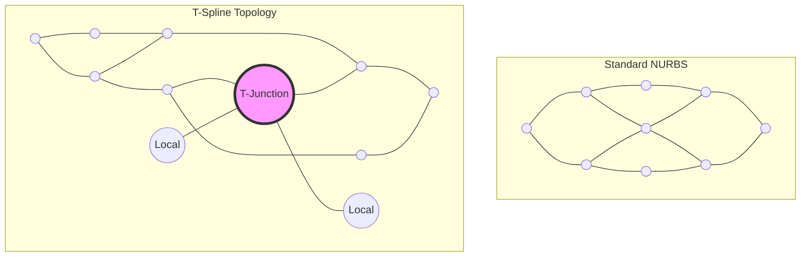
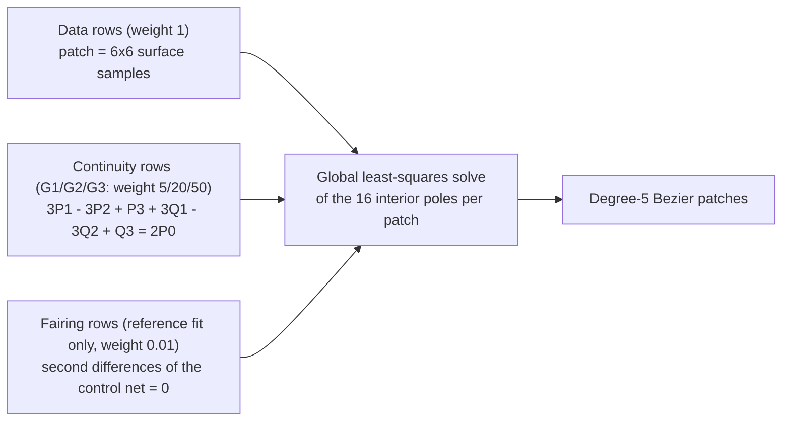

# Advanced Surface Modeling Features

This document provides visual tutorials and documentation for the advanced features introduced in our surface modeling toolkit: GPU Subdivision, T-Splines, and NURBS patch fitting.

## 1. GPU Subdivision

GPU Subdivision offloads the computational heavy lifting of surface refinement to the graphics processing unit. This allows for real-time visualization of high-density meshes.

### Key Benefits
*   **Real-time Performance:** Manipulate base meshes while seeing the subdivided limit surface instantly.
*   **Memory Efficiency:** Subdivision happens on the fly in the GPU pipeline (e.g., using tessellation shaders), saving host memory.
*   **Adaptive Tessellation:** Dynamic level of detail based on camera distance or surface curvature.

## 2. T-Splines

T-Splines are an evolution of NURBS that allow for local refinement without the need for control points to propagate across the entire surface. This is achieved by allowing T-junctions in the control grid.

### T-Spline Topology

The following diagram illustrates the difference between standard NURBS and T-Spline topology:

*In a standard NURBS grid, inserting a control point adds an entire row/column. In a T-Spline, a T-junction allows a partial row/column, drastically reducing the number of unnecessary control points.*

## 3. NURBS Patch Fitting and the Continuity Options

`SubDToNURBSConverter` (GUI "Convert to NURBS", `python -m src.convert`) turns every quad of the cage into one degree-5 Bezier patch (6x6 control points) and fits all patch interiors in one global least-squares solve (`G3Fitter.fit_surface`; the "G3" in the name is historical).

What is guaranteed and what is not:

| Property | Status |
|----------|--------|
| G0 - neighbouring patches share their boundary curve exactly | always (boundary control rows are fixed from the cage corners and tangent-plane chords) |
| G1 - tangent continuity across patch edges | **not enforced** (on reference fits the boundary curves at a cage vertex lie in its tangent plane, without a reference they are straight chords; along an edge the two sides generally kink) |
| G2 - curvature continuity | **not enforced** |
| Third-derivative (C3) matching across shared edges | added by `--continuity G1`, `G2` and `G3` alike |

### The rows of the fit

* **Samples.** With a reference mesh (the STL reverse-engineering path) each quad's bilinear 6x6 grid is projected onto the reference. Without one (SubD modelling) the samples are points of the true Catmull-Clark limit surface, from two levels of subdivision (creases included).
* **Continuity rows.** For every shared edge and every interior boundary column, P0 is the shared boundary pole and P1..P3 / Q1..Q3 are the next poles inward on either side; the row matches the third cross-boundary derivatives. The solve is exact, so any weight of order 1 or more acts like a hard constraint, and G1, G2 and G3 give practically the same surface (max interior difference 1.3e-4 mm on a 2152-quad part). G0 adds no continuity row. Creased cage edges (crease weight > 0) never get continuity rows.
* **Fairing rows.** On reference fits every second difference of the control net along u and v that touches an interior pole is pulled towards zero with weight 0.01. This damps the pole oscillations that noisy projected samples excite in the badly conditioned 6x6 fit (on a real topology-optimisation part: 44 patches reset to Coons without it, 0 with it). Planes and bilinear patches are unaffected.

### Why not real G1/G2

Hard tangent (C1) rows were measured in 2026-10 on a 2152-quad topology-optimisation cage: audit deviation +24 % (mean) and +37 % (p95), and 591 patches reset by the divergence clamp, because most quads touch an irregular vertex (where the rows of different edges conflict) and the boundary curves are fixed. True G1/G2 would need boundary curves fitted to the surface and a vertex-enclosure treatment; it is left as a possible later opt-in.
